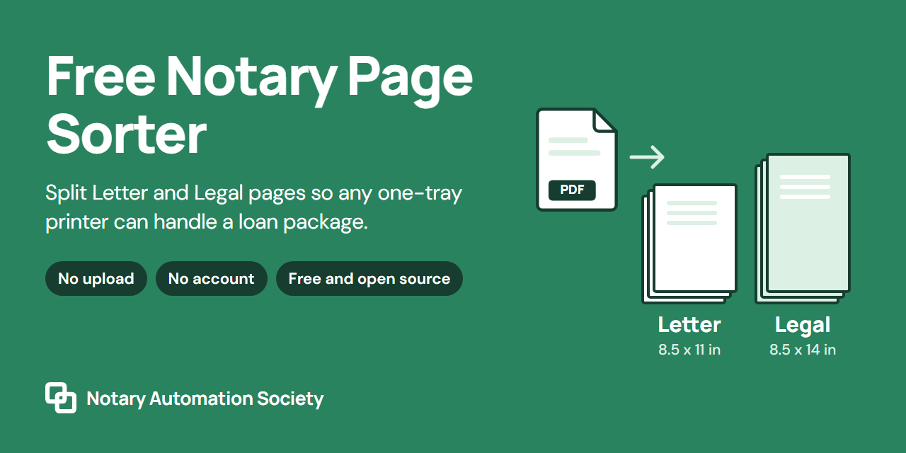
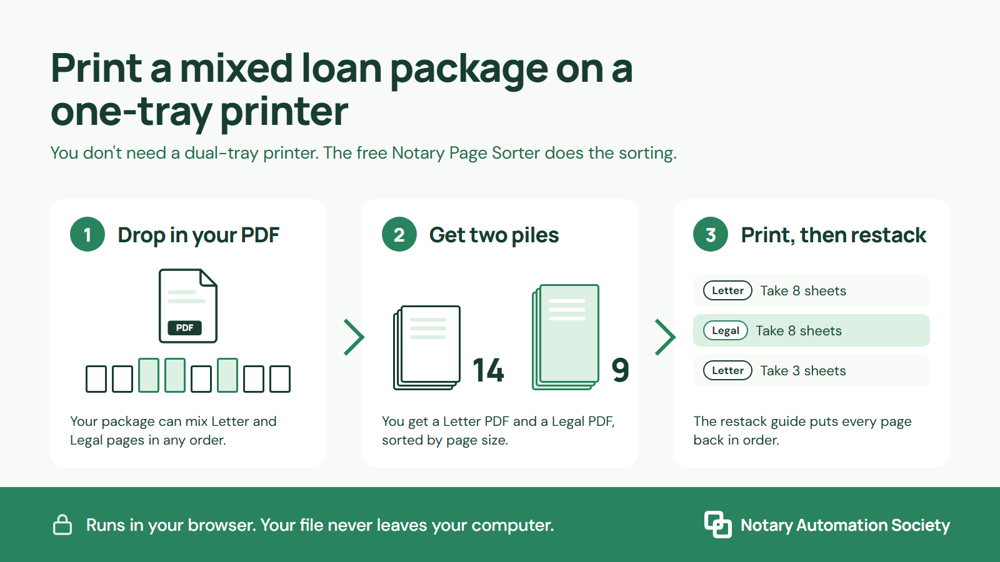
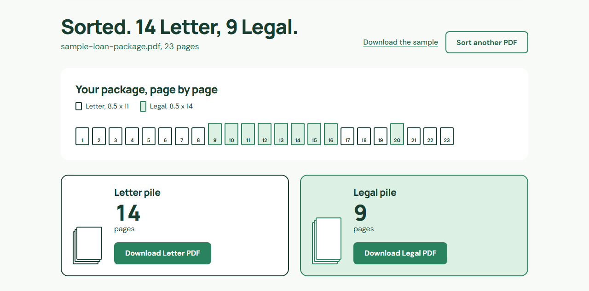
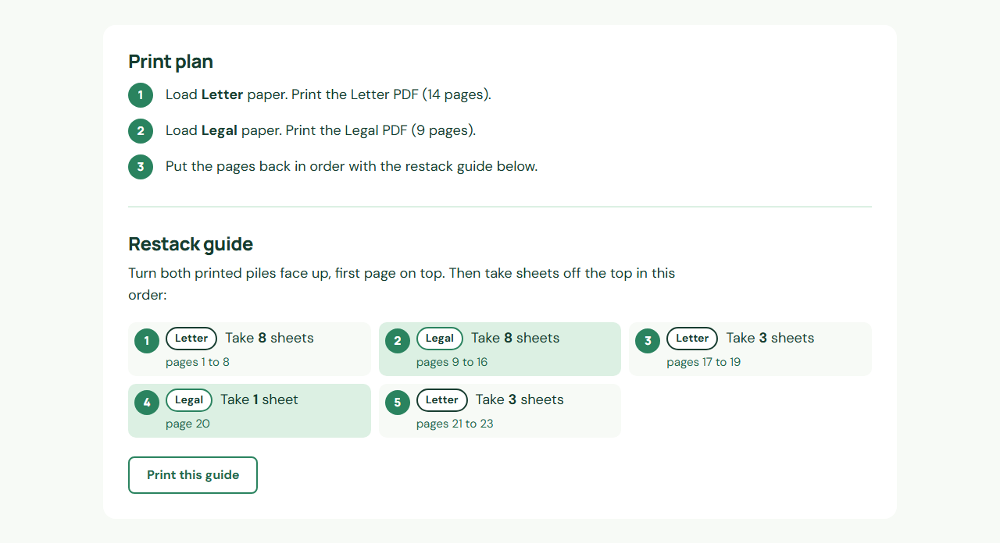

# Notary Page Sorter

A free tool that splits a mixed loan package into a Letter PDF and a Legal PDF, so you can print it on a printer with one paper tray. It also gives you a restack guide that shows where each Legal page goes back in.

It runs in your web browser, on your own computer. Your PDF is never uploaded, you don't need an account, and it works with the internet turned off.

Made by Notary Automation Society, a free community where notaries learn to use AI, organize their business information, and make everyday tasks easier.

## How it works

1. Drop your loan package PDF on the page.
2. The sorter measures every page. Letter pages are 11 inches tall and Legal pages are 14.
3. Download the two PDFs. Print the Letter one on Letter paper, then load Legal paper and print the Legal one.
4. Follow the restack guide to put the pages back in order.

## Start using it (about one minute)

1. Click the green **Code** button near the top of this page, then click **Download ZIP**.
2. Right-click the ZIP file and choose **Extract All**.
3. Open the extracted folder and double-click **index.html**. It opens in your web browser.
4. Drop in a PDF, or click **Try a sample package** to see it work first.

Tip: put the folder on your Desktop and bookmark the page so it's one click away before every signing.

## What you'll see

The page map shows every page in order. Legal pages are the taller, green ones.

The restack guide tells you how many sheets to take from each pile, in order. Click **Print this guide** to keep a paper copy next to your printer.

## Is my loan package safe?

Your file stays on your computer. The page reads the PDF and builds the two new PDFs inside your browser. It also has a security rule (a Content Security Policy) that blocks it from sending anything over the internet. To test it, turn off your Wi-Fi and sort a file.

The code is short and open. You, or any AI assistant, can read every line in `app.js`.

## Good to know

- Pages that are not exactly Letter or Legal, like A4, go in the closest pile and get a dashed outline so you can check them.
- Many lender packages are locked but open without a password. Those sort right away. If a PDF needs a password, the page asks for it, and the password stays on your computer too.
- The sample package is made up. Every page says SAMPLE and shows its paper size, so it's safe to show on camera.
- Always count your printed sheets and compare them with the original package before a signing. This tool helps with printing. It does not review documents.
- Tested in Google Chrome on Windows. It uses standard browser features, so other current browsers should work too.

## Change it

Everything is plain HTML, CSS and JavaScript. There's nothing to install and no build step.

- `index.html` is the page, `app.js` does the sorting, and `styles.css` holds the look.
- `config.js` holds the community link for the "Join the free community" button.
- `sample.js` builds the made-up sample package.
- The pictures in `docs/` come from `docs/source/visuals.html`.

Want a change but don't code? Open this folder in Claude Code, Codex or another AI coding assistant and describe what you want.

## Credits

- Inspired by the free PDF Page Sorter from Notary Rotary. This is an independent project and is not affiliated with Notary Rotary.
- PDF reading and writing by [pdf-lib](https://github.com/cantoo-scribe/pdf-lib) (Cantoo's maintained version, MIT license), included in `vendor/`.
- Fonts: Manrope and DM Sans from [Google Fonts](https://github.com/google/fonts), SIL Open Font License, included in `assets/fonts/` with their license files.

## License

The code is MIT licensed, so you can use, share and change it for free. See [LICENSE](LICENSE). The Notary Automation Society name and logo are not covered by that license.
